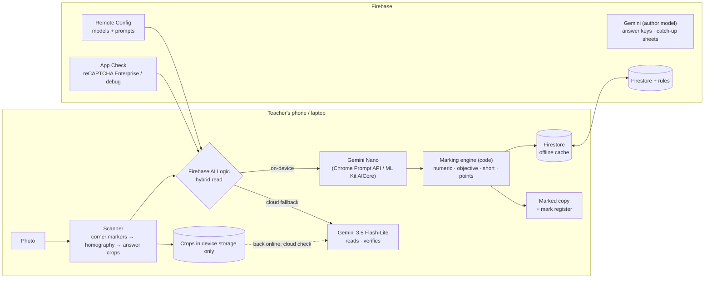

<p align="center"></p>

**REDPEN marks a stack of handwritten classwork in minutes — on the teacher's own phone or laptop, even offline.**
Gemini Nano reads each pupil's answer on the device, ordinary code does the marking against the teacher's own scheme,
and when the device is back online Gemini in the cloud double-checks every on-device mark. Built on **Firebase AI Logic hybrid inference**
for **Web (Chrome)** and **Android**, sharing one Firestore data model.

---

## Try it in 2 minutes

| | |
|---|---|
| **Live web app** | https://redpen-hybrid.web.app |
| **Android app** | Release APK on the [Releases page](../../releases) (Android 8.0+). Install, open, tap a sample. |
| **Accounts** | None needed — you start as a private guest. "Save my work" links a Google account. |

**Fastest path (any browser, no printer):**
1. Open the web app → **Quick mark a page**.
2. Upload [`samples/maths.png`](samples/maths.png) — a real pupil's exercise page (questions + handwritten answers, two deliberately wrong).
3. REDPEN drafts the answer key from the *questions only* → click **Looks right — mark it** → **5/7**, with "23" and "25" caught.

**The hybrid path (printed sheet, on-device, offline):**
1. Use a desktop Chrome that supports built-in AI ([requirements](https://developer.chrome.com/docs/ai/get-started)), or an Android phone with Gemini Nano (Pixel 9/10/11, Galaxy S25/S26, …).
2. Home → **English — Grammar Check** sample → **Print sheets** (or use [`samples/english-sheet-photo.jpg`](samples/english-sheet-photo.jpg)).
3. Status bar → **Enable on-device AI** (one-time model download).
4. Go offline → **Mark** → photograph the sheet → every mark shows **On-device · Marked by code · Provisional**.
5. Go back online → **Review** → the cloud check runs automatically; agreements become **Verified**, disagreements are shown side by side for the teacher.

**Run locally**
```bash
git clone https://github.com/egbujor-emmanuel/redpen && cd redpen/web
cp .env.example .env.local        # fill in your Firebase web config
npm install && npm run dev        # http://localhost:5173
npm test                          # 36 unit tests (marking engine + scanner geometry)
```
Android: open `android/` in Android Studio, add your `app/google-services.json`, run. CI builds and unit-tests every push ([workflow](.github/workflows/android.yml)).

---

## Why hybrid is structurally necessary here

| Problem | What REDPEN does |
|---|---|
| Teachers in large, low-connectivity classes mark by hand for hours; feedback arrives days late. | Marking runs **on the device**, offline, at **zero cost per page**. |
| Cloud graders upload children's work to a server. | On printed sheets only the **cut-out answer boxes** are read — the pupil's name line never leaves the device. Crop images stay in device storage, never in Firebase. |
| Small on-device models "auto-correct" pupils — we measured Nano reading a pupil's **23** as **24** when it could see the question. | The model **only reads** one answer box and never sees the question; **code decides every mark**. Theory answers get one small yes/no check per marking point. |
| On-device reads are sometimes wrong. | On-device marks are **Provisional** until the **cloud check** (Gemini via Firebase AI Logic) re-reads them; disagreements go to the teacher with both readings. |
| The cloud is sometimes overloaded (we hit "high demand" errors during testing). | Retries with backoff, an authoring-model fallback, and the on-device path keep teachers working. |

## Architecture



**Firebase products used:** AI Logic (hybrid `PREFER_ON_DEVICE`, `PREFER_IN_CLOUD`, `ONLY_IN_CLOUD`; structured output on both paths; `inferenceSource`), App Check (reCAPTCHA Enterprise on web, debug provider for sideloaded test builds, Play Integrity for store builds), Authentication (anonymous guest → Google linking), Firestore (offline persistence, per-teacher security rules), Remote Config (model names and prompts — never hard-coded), Hosting, App Distribution.

Because the Firebase console does not show on-device inference, REDPEN records every inference's source and latency itself (`users/{uid}/telemetry/{day}`) and shows a live on-device / cloud counter in the app.

## Features

- **Quick mark** — one photo of a pupil's page → AI answer key from the questions → teacher confirms → marked. Key saved for the class.
- **Assignments** — draft a marking scheme from a photo/PDF of the question paper, edit it, print answer sheets with corner markers.
- **Two capture modes** — printed REDPEN sheet (fully offline, names private) or any exercise-book page.
- **Marked copy** — the pupil's own page with red ticks, crosses, scores and a circled total, to print or share. The teacher writes only the total on the original — no second round of marking.
- **Mark register** — pupils × questions with totals; export to Excel (CSV) or print.
- **Review** — flagged answers with the pupil's handwriting beside what the AI read; set a score or "accept this answer for everyone" (updates the scheme).
- **Insights + catch-up** — per-question averages, answers that lost marks, and an AI catch-up worksheet built from the class's actual mistakes.
- **Accounts** — private guest by default; Google sign-in keeps all work and syncs web ↔ Android. Active / finished assignments, full delete.
- Any subject with a marking scheme; any level (Grades, Years, Primary, JSS/SS, Basic/SHS, Forms, Classes).

## Evidence

| Test | Result |
|---|---|
| Unit tests — web (Vitest) | 36 / 36 pass |
| Unit tests — Android (JUnit, same cases) | pass in CI |
| Real handwriting (3 photos, 14 questions), cloud reading + code marking | 14 / 14 marks correct, incl. partial 2/3 and a "do not accept" answer |
| Same photos, on-device whole-page marking (rejected design) | auto-corrected 2 wrong answers → why REDPEN reads answer-only crops |
| On-device crop reading + code marking | 7 / 10 exact, every miss either flagged or caught by the cloud check |
| Live end-to-end offline → online run (Chrome + Gemini Nano) | 5 answers marked 100 % on-device offline; on reconnect the cloud check verified 4 and flagged the one device misread |
| Quick mark on a real page | answer key 6/6 correct (ignored the pupil's wrong answers); marked 5/7 correctly |

Benchmark scripts and evidence live in [`bench/`](bench/).

## Repository

```
web/        React + Vite PWA (TypeScript) — marking engine, scanner, AI layer, UI
android/    Kotlin + Jetpack Compose — same engine, scanner and Firestore schema
firestore.rules, firestore.indexes.json, firebase.json
.github/workflows/android.yml   unit tests + APK on every push
```

## License

[Apache 2.0](LICENSE)
